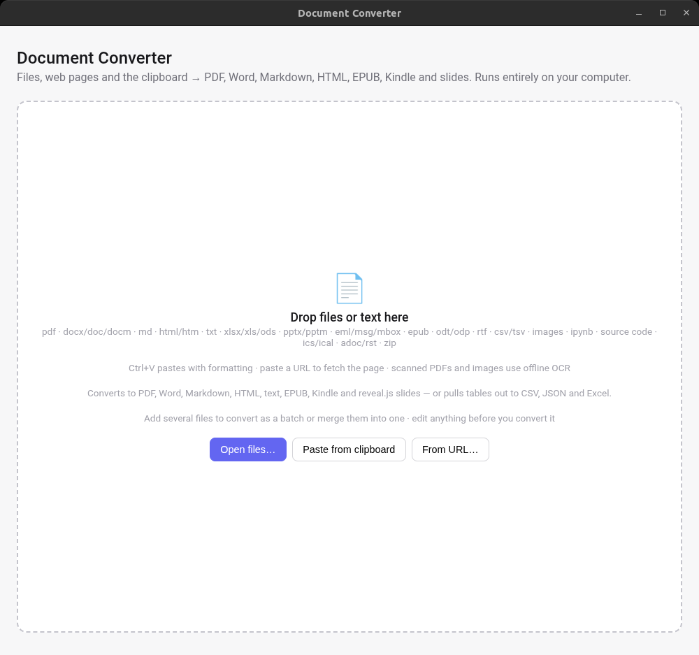
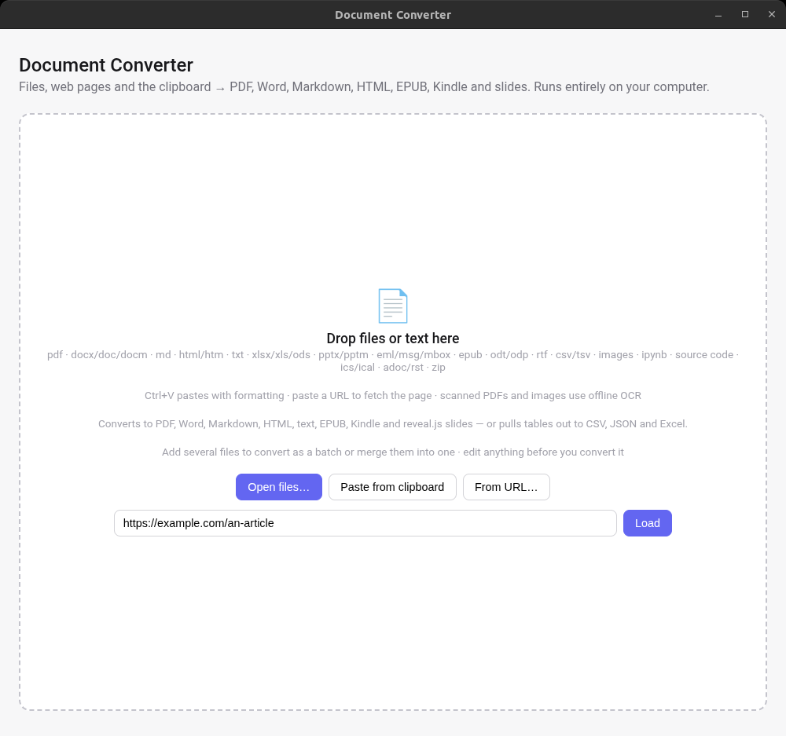
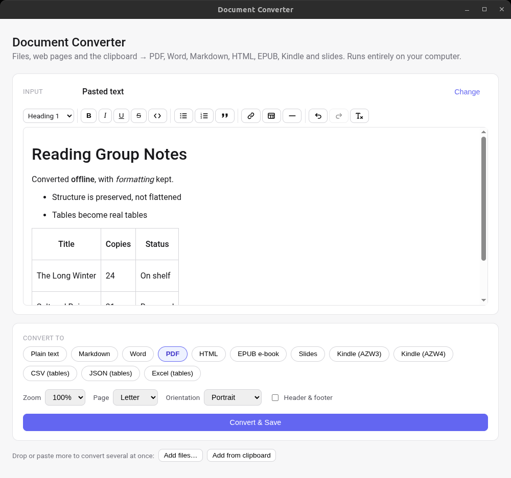
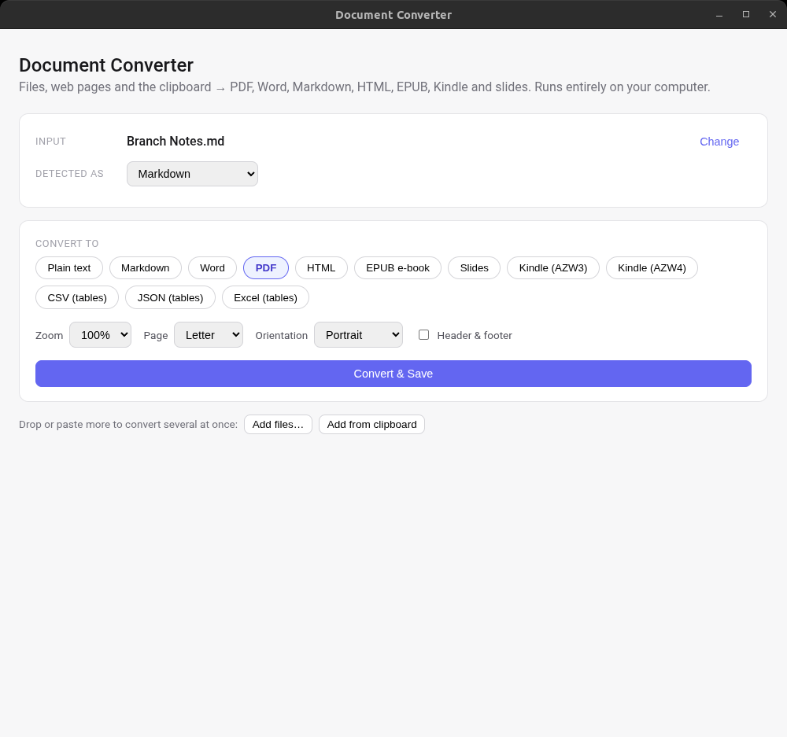

# Document Converter

Convert documents between 31 input formats and 12 output formats on your own
machine. Your documents are never uploaded, there is no account and no
telemetry. The app goes to the network for three things: a web page you ask it
to fetch, the images a document or a paste refers to by web address (so they
can be embedded in the output), and an OCR language pack you select. Remote
images in email and calendar invitations are never fetched. See
[Images and the network](#images-and-the-network).




Online converters upload the file you give them. This one does the conversion
locally, and the code that does it is in this repository.

---

## Contents

- [Install](#install)
- [What's new in 1.4](#whats-new-in-14)
- [What's new in 1.3](#whats-new-in-13)
- [What's new in 1.2](#whats-new-in-12)
- [What's new in 1.1](#whats-new-in-11)
- [What it reads](#what-it-reads)
- [What it writes](#what-it-writes)
- [Images and the network](#images-and-the-network)
- [What it is good at](#what-it-is-good-at)
- [What it deliberately does not do](#what-it-deliberately-does-not-do)
- [Batch and merge](#batch-and-merge)
- [Settings](#settings)
- [Command line](#command-line)
- [Development](#development)
- [Project layout](#project-layout)
- [License](#license)

## Install

Download the release for your platform:

| Platform | File |
| --- | --- |
| Windows x64 | `docconversion-<version>-setup.exe` |
| Linux x64 | `docconversion-<version>.AppImage` |
| macOS x64 | `Document Converter-<version>-mac.zip` |

The builds are **not code signed**. Windows SmartScreen will warn on first run —
choose *More info* then *Run anyway*. On Linux, mark the AppImage executable
with `chmod +x` before running it. On macOS, Gatekeeper refuses an unsigned app
on first launch: right-click it and choose *Open*, or clear the quarantine
attribute with `xattr -d com.apple.quarantine "Document Converter.app"`.

The macOS build is x64 only; Apple Silicon runs it under Rosetta 2.

## What's new in 1.4

- **Settings.** A Settings dialog holds the defaults for choices most people
  make once. Open it with **File → Settings…** (Ctrl+,) on Windows and Linux,
  **Settings…** (Cmd+,) on macOS, the start screen's *Settings* link or the
  conversion screen's gear button. Its seven sections cover pictures, the web,
  formulas and diagrams, code, PDF, reading and OCR, and every setting says
  which outputs it affects. Settings are remembered from one start to the next; a
  change on the conversion screen lasts only until you quit. See
  [Settings](#settings).
- **PDF orientation is Automatic.** The toolbar's Orientation starts at
  *Automatic*, which picks the page for the document: a wide picture or
  drawing opened on its own prints on a landscape page, a fax or TIFF of
  portrait and landscape pages keeps each page's own orientation, and a
  document that is mostly tables too wide for a portrait page (a wide
  spreadsheet) prints landscape. Everything else stays portrait. *Portrait*
  and *Landscape* print every page that way, exactly as before. On the
  command line it is `--orientation auto|portrait|landscape` (`auto` by
  default); `--landscape` still works and means `--orientation landscape`.
  Word output has the same Orientation choice and rule: a fax of portrait and
  landscape pages becomes a Word file with one section a page, each turned as
  its picture is.
- **Pictures an output can't hold are converted to the right kind.** A TIFF
  in a PDF or a WebP in a Kindle book becomes PNG when it is a screenshot,
  line art, a diagram, a scan or a GIF (few colors or large flat areas), so
  lines and text stay sharp, and JPG when it is a photograph, much smaller.
  Pictures with see-through parts stay PNG, and drawings stay SVG where the
  output allows it, otherwise PNG. Settings → Pictures (or `--pictures`) can
  make them all JPG or all PNG instead.
- **Web pictures, intranet pictures and code color can be turned off.**
  Settings → Web stops the app downloading the pictures a document refers to by
  web address (each becomes its description, and the result says how many), or
  refuses intranet addresses only. Settings → Code writes code blocks plain
  black instead of colored by language.
- **Every web picture is fetched, intranet ones included.** 1.3 stopped at 100
  images and 25 MB a document and refused intranet addresses. Now there is no
  count or total, each picture may be up to 200 MB, and private addresses such
  as `http://intranet/logo.png` load. This machine and cloud metadata addresses
  are still refused. See [Images and the network](#images-and-the-network).
- **The command line takes the same settings.** `--settings <file>` starts from
  a settings file and `--settings app` from the app's own; without either, the
  built-in defaults are used and nothing on disk is read. New flags:
  `--pictures <auto|jpg|png>` and `--ocr-lang <code>`, and the pairs
  `--fetch`/`--no-fetch`, `--local-network`/`--no-local-network`,
  `--code-color`/`--no-code-color` and `--header-footer`/`--no-header-footer`,
  so a flag can turn back on what a settings file turns off. See
  [Command line](#command-line).
- **Large drawings and workbooks take less time and memory.** A 12 MB SVG
  file converts to Word in about 3 seconds, was 18, and no longer needs more
  than a gigabyte of memory to be cleaned. Excel output is written as it goes and
  compressed: a million rows take about 3 seconds and 300 MB, were 10 seconds
  and 3 GB, and the file is a sixth of the size. An empty cell is now empty
  in Excel, not empty text.
- **A SQLite view cannot take the app down.** A view that would need more
  memory than a database is given (a quarter of the computer's, at most
  1.5 GB) is stopped with a message, and the rest of the database is still
  converted.

## What's new in 1.3

- **Pasted images show up.** Copying from a web page puts only the images'
  addresses on the clipboard, and the editor would not load them, so each one
  was an empty box. The app now downloads them and embeds them before the
  editor opens. A progress bar counts them, and *Skip remaining images* opens
  the editor at once with what has arrived.
- **A document's web images are embedded in every output.** An `.html` or `.md`
  file that refers to images by web address now gets those images embedded when
  it is read, so html, slide and e-book output no longer depends on the website
  staying up.
- **A dead image no longer fails a Word document.** An image the Word writer
  could not download made the whole conversion fail with "console.warning is
  not a function".
- **Email and calendar invitations never load remote images.** Those images are
  how a sender learns a message was opened, and from where. They are replaced
  by their description, as a mail client does.
- **Conversion makes no network requests of its own.** The Word writer and the
  PDF renderer used to fetch remote images themselves, without the checks that
  keep a document from reaching addresses on your local network. All fetching
  now goes through one guarded path, and the PDF renderer is cut off from the
  network entirely.
- **A larger image budget.** Up to 100 images and 25 MB per document or page,
  was 20 and 10 MB, downloaded four at a time.
- **A web page or error served in place of an image is not embedded.** It
  becomes the image's description instead of a broken picture.

## What's new in 1.2

- **A file is read again every time it is converted.** 1.1 read a file once,
  when it was added, and converted those bytes from then on: edit the file in
  another program, convert again, and the output was the old version with
  nothing to say so. The app now goes back to the disk at each conversion.
  Pasted text, a fetched page and the entries of a zip have no file to go back
  to, and stay as they were added.
- **Edits made in the editor survive a conversion.** Dismissing a result rebuilt
  the editor from the original text, so the edits were gone and the next
  conversion quietly produced the original. Canceling the save dialog lost them
  the same way. Edits are now stored before any result is shown, whatever the
  result is.
- **A file that changes on disk while it is open in the editor is not reloaded
  behind your back.** Your edits win. A notice says the file changed on disk and
  offers *Reload from disk* or *Keep my edits*; the conversion uses your edits
  until you choose.
- **A file that was moved, renamed or deleted is reported by name** instead of
  being converted from the bytes it used to have. In a batch it costs its own
  row and nothing else.
- **Edit opens a file as it is now**, not as it was when it was added.

## What's new in 1.1

- **OCR language packs install on Windows.** 1.0 refused every pack there with
  "Unknown OCR language": the check that keeps a pack inside its folder compared
  the path against a `/`, and Windows paths use `\`.
- **All 25 OCR languages can be installed.** The checksum table that verifies a
  download now covers every language in both model sets; 1.0 recorded three.
  The pack list shows each file's real size.
- **PDF zoom defaults to 90%.** The on-screen prose size printed a little large
  at 100%. The app, the CLI's `--scale` and the headless path all start at 0.9.
- **A horizontal rule starts a new page in PDF output.** `---` in Markdown, a
  transition in reStructuredText, or the seam between messages in an mbox now
  breaks the page rather than drawing a line. The rule itself is hidden. Two
  rules in a row give one break, a closing rule adds no blank page, and a rule
  that opens the document leaves the first page in place.

## Screenshots

| Paste a URL | Edit before converting | Choose the output |
| --- | --- | --- |
|  |  |  |

Anything pasted or fetched opens in an editor first, so you can trim it before
converting. Pasted Markdown arrives as formatted text, not as raw syntax.

## What it reads

The internal names are in `SOURCE_FORMATS` in `src/core/types.ts`:

```
txt, md, docx, pdf, html, eml, msg, csv, xlsx, rtf, image, svg, metafile,
code, ipynb, pptx, doc, epub, mbox, odt, odp, ics, asciidoc, rst, json,
subtitles, opml, vcard, djot, textile, sqlite
```

Some of those names cover more than one file extension. The extensions are in
`EXTENSION_FORMATS` in `src/core/extensions.ts`, and the start screen lists
them from there.

A file is read by its extension, unless its contents are beyond doubt
something else: a picture, a PDF, or an Office, OpenDocument, EPUB or Outlook
file named as text (`.txt`, `.md`, `.csv`, source code and the like) is read as
what it is, and the app says so ("This file is named .txt but is a TIFF
picture; read as a picture."). Text that only starts like one stays text.

- **Word.** `.docx` and `.docm` are read fully. `.doc` (Word 97 to 2003) is read
  for its text only, and the app tells you what it could not recover.
- **Spreadsheets.** `xlsx` covers `.xlsx`, `.xls` and `.ods`. `.csv` and `.tsv`
  are tables too.
- **Presentations.** `pptx` covers `.pptx` and `.pptm`, `odp` covers
  OpenDocument slides (`.odp`). `.odt` is OpenDocument text.
- **Web pages.** `.html` and `.htm`.
- **Text and Markdown.** `.txt` and `.text`; Markdown as `.md`, `.markdown`,
  `.mdown`, `.mkd`, `.mkdn`, `.mdwn` and `.markdn`, and R Markdown and Quarto
  (`.rmd`, `.qmd`) with their code chunks.
- **Other documents.** `.pdf`, `.rtf` and `.epub`.
- **Email.** `.eml`, `.msg` (Outlook) and `.mbox` archives.
- **Calendars and contacts.** `.ics` and `.ical` invitations; vCard contacts
  (`.vcf`, `.vcard`), one row per contact. A `.vcf` that is not a vCard is
  the genomics Variant Call Format and is read as text.
- **Images.** `.png`, `.jpg`, `.jpeg`, `.gif`, `.webp`, `.tif`, `.tiff`,
  `.bmp`, `.avif` and `.ico`. Embed the image in the output, or run text
  recognition on it. Each page of a TIFF (a fax, a scanned letter) becomes a
  page of its own, recognized page by page. Word keeps a TIFF as it is; an
  output that can't hold a picture gets PNG or JPG. HEIC (iPhone photos) is
  not read: Chromium cannot decode it, so save it as JPEG first.
- **Drawings.** `.svg`, and Word's vector pictures `.emf` and `.wmf`
  (`metafile`), are kept as drawings where the output allows it: SVG, its text
  still text (selectable in a PDF), otherwise PNG. Word keeps an EMF or WMF as
  it is. A drawing's text is its description. An EMF or WMF also converts to
  plain text, as its labels in reading order (top to bottom, left to right),
  one a line, and to Markdown, as the drawing followed by a list of its labels.
- **Source code.** More than 80 extensions, and names such as `Dockerfile` and
  `Makefile`, listed in `EXT_TO_LANG` in `src/core/code-langs.ts`, syntax
  highlighted in the output.
- **Notebooks.** `.ipynb` rendered with `In [n]:` / `Out[n]:` prompts, with
  code, output and errors styled differently.
- **Data.** JSON (`.json`) and JSON Lines (`.jsonl`, `.ndjson`): an array of
  flat records reads as a table, anything else as formatted JSON. SQLite
  databases (`.sqlite`, `.sqlite3`, `.db3`, and a `.db` or any other name that
  starts with the SQLite header): the schema and every table, and the views'
  rows if you ask for them.
- **Subtitles and transcripts.** WebVTT (`.vtt`) and SubRip (`.srt`), and
  Teams meeting transcripts: who said what, and when.
- **Markup and outlines.** AsciiDoc (`.adoc`, `.asciidoc`, `.asc`),
  reStructuredText (`.rst`), Djot (`.djot`, `.dj`), Textile (`.textile`) and
  OPML outlines (`.opml`).

Three inputs are not file formats:

- **The clipboard.** Ctrl+V or *Paste from clipboard*. Formatting from Teams,
  Word and Outlook survives, including tables, links and images. Images a web
  page puts on the clipboard by address are downloaded and embedded; see
  [Images and the network](#images-and-the-network).
- **A web page address.** Paste a link or use *From URL*. The readable article
  is extracted with Mozilla Readability and its images embedded, every one of
  them.
  Every redirect hop is checked against loopback and link-local addresses, so
  a page cannot make the app fetch something on your own machine or a cloud
  metadata service. Intranet addresses are allowed.
- **A ZIP archive.** Expanded into its convertible entries, each becoming a
  separate input. Junk entries such as macOS resource forks are skipped, with a
  cap of 100 entries.

Drop files anywhere in the window, including onto a list you have already
loaded.

## What it writes

The output formats are in `TARGET_FORMATS` in `src/core/types.ts`:

```
txt, md, docx, pdf, html, epub, revealjs, azw3, azw4, csv, json, xlsx
```

**Documents**

- **txt** — plain text.
- **md** — Markdown with GitHub-style pipe tables.
- **docx** — a Word document, on Word's own page: Letter with 1-inch margins.
  Orientation is chosen as for pdf: Automatic unless you choose Portrait or
  Landscape. A
  document of pictures a page (a TIFF) gets a page, and a section, a picture,
  each turned as its picture is. A picture larger than its page is made to fit.
- **pdf** — rendered by Chromium. Zoom 50–200% (90% by default), page size
  (Letter, A4, Legal, A3, Tabloid), orientation, and an optional header and
  footer with the title, date and page numbers. A horizontal rule (`---` in
  Markdown) starts a new page. Orientation is Automatic unless you choose
  Portrait or Landscape: landscape pages for a wide picture on its own (each
  page of a TIFF by its own shape) and for a document that is mostly wide
  tables, portrait for the rest.
- **html** — one standalone file.
- **epub** — an e-book. Chapters split on the document's own headings, images
  stored once each, markup written as XHTML because e-book readers require
  well-formed XML.

**Slides**

- **revealjs** — a [reveal.js](https://revealjs.com) deck as a single
  self-contained HTML file. Slides are separated by a horizontal rule (`---` in
  Markdown) or by a heading level you choose; Automatic uses heading 1, or
  heading 2 when heading 1 is only the title. Speaker notes written as
  `<!-- notes: ... -->` reach reveal's speaker view.

**Kindle**

- **azw3** — a reflowable Kindle e-book (KF8), built from the same content as
  the EPUB output.
- **azw4** — a Kindle print replica: your PDF in a Kindle container. It does not
  reflow, so it is rendered at Kindle page size regardless of the page setup you
  chose: a Letter page shown on a 6-inch screen puts the text at roughly a third
  of its intended size.

**Tables** (`TABLE_TARGETS`)

- **csv** — one file per table found in the document.
- **json** — one file per table, keyed by the header row when there is one.
- **xlsx** — one workbook, one sheet per table. A table longer than Excel's
  1,048,576 rows continues on a second sheet, its header row repeated.

No output refers to the network: every image is embedded in the file, or
replaced by its description.

There is also a *Convert to clipboard* button, which puts both a rich HTML and a
plain text version on the clipboard. It is hidden for outputs whose bytes are
not text (Word, PDF, EPUB, Excel, Kindle), and for slide decks, which are a
complete HTML document with about 240 KB of JavaScript inlined.

## Images and the network

A document can refer to an image by web address instead of containing it: a
saved web page, a Markdown file with ``, a paste from a
browser. The app downloads such images when the input is read and embeds them,
so the editor shows them and every output carries them. This is **on by
default** and applies to:

- a file you open or drop, whatever its format;
- a paste, from Ctrl+V or *Paste from clipboard*;
- a web page fetched with *From URL*;
- the command line, which reads inputs the same way.

Opening a document that refers to remote images therefore contacts the servers
that host them, which tells those servers your IP address and that the
document was opened. **Settings → Web** turns this off, or refuses intranet
addresses (see [Settings](#settings)); on the command line `--no-fetch` and
`--no-local-network` do the same (see [Command line](#command-line)).
Two exceptions are built in:

- **Email and calendar invitations** (`.eml`, `.msg`, `.mbox`, `.ics`) never
  have their remote images fetched. Senders use them to learn that a message
  was opened, so they are replaced by their description, as a mail client does.
- **Relative paths** (`images/fig.png`) name a file beside the document, not a
  web address, and are left as they are.

Every download goes through the same checks as *From URL*:

- Only `http` and `https`. Pictures on your intranet are fetched, unless
  Settings → Web says not to: private addresses (10.x, 172.16–31.x, 192.168.x,
  IPv6 `fc00::/7`) and single-word host names such as
  `http://intranet/logo.png`. Each redirect hop is checked,
  and this machine (`localhost`, 127.x, `::1`), link-local addresses
  (169.254.x, where cloud metadata services answer, and `fe80::`), and
  multicast and reserved addresses are refused, so a document cannot make the
  app reach a service on your own machine. The connection is made to the
  address that was checked, so a name cannot change its answer in between.
- Every image is fetched, however many there are, four at a time, with 10
  seconds allowed per image. A single image may be up to 200 MB, so that one
  response cannot exhaust memory.
- The body must actually be an image. A login page, an error page or a JSON
  reply sent in place of an image is not embedded.

An image that cannot be fetched, is over 200 MB, or is skipped becomes its
description, such as `[image: quarterly chart]`. A paste shows its progress
("Fetched 3 of 12 images"); *Skip remaining images* opens the editor straight
away with the images that have arrived. During a conversion the usual *Cancel*
applies.

The writers never fetch anything themselves. Any remote reference still present
when a document is written is replaced by its description, and the window that
renders PDF output has no network access at all.

## What it is good at

**Tables.** Recovered from every source that carries one — the easy cases (HTML,
Markdown, spreadsheets, CSV) and the hard ones:

- A PDF has no table structure, only text and its position, so the grid is
  inferred from the geometry. On the test corpus this recovers 408 of 409 rows
  across 20 tables, with no false tables on a 70-page document of ordinary
  prose.
- The same inference runs on text-recognition output, so a scanned table can
  become a CSV file.
- RTF tables are parsed from the control words, and nested tables stay nested.
- reStructuredText simple tables, grid tables and column spans use ports of
  docutils' own algorithms.
- A `.txt` file whose columns are separated by tabs is read as a table.

**Text recognition.** A PDF with no text layer, or an image, is read with
tesseract.js, offline, in a separate process. English ships with the app; 24
further languages are downloaded only when you ask for one, verified by
checksum, and stored alongside it. The confidence threshold is set per script, and no
uncalibrated script is given a lower threshold than English, which was
measured.

**Images in PDFs.** Extracted and placed back into the output in reading order.

**Large tables in PDF output.** Chromium's `printToPDF` refuses documents above
a size that depends on the shape of the content, and clips wide tables with no
warning and no error. Large tables are split across several print calls and the PDFs
joined, repeating the header row on each part.

**Page fit advice.** Before printing, the app estimates how wide the widest
table needs to be, and suggests the smallest page setup that fits. It never
changes the paper size. Orientation it changes only in Automatic, the default,
and only for a document that is mostly tables too wide for a portrait page; a
report with one wide table among its text stays portrait and gets the tip
instead. Portrait and Landscape are kept exactly as chosen.

**Merging.** Several inputs into one document. When the output is PDF and the
inputs are PDFs, pages are copied straight across rather than re-rendered, so
text layers, images and scanned pages survive unchanged.

## What it deliberately does not do

Most of the limits below are choices rather than gaps.

**It does not reproduce layout.** This converts content, not appearance. Fonts,
margins, columns and exact spacing are not carried across. If you need the
output to look like the input, this is the wrong tool.

**It does not guess at a table it cannot read.** A wrong table is worse than no
table, because it silently reorders the document's content.

- Grid inference declines when the geometry is not convincing; the PDF
  confidence floor is 0.75.
- Text recognition passes three separate checks before its output becomes a
  table. A paragraph of prose looks like a grid when all you have is the
  position of each word — one became a 17-column table before those checks
  existed.
- A `.txt` file whose columns are aligned with spaces is not read as a table.
  Indented code and aligned prose cannot be told apart from columns without
  understanding the text.
- A `.doc` file produces no tables. The old Word format keeps a marker at the
  end of each cell but no column geometry, so the grid cannot be rebuilt. The
  cell markers are made visible as ` | ` instead, which shows where the cells
  divided without asserting a column structure that cannot be determined.

**It reports what it could not recover from a `.doc`.** Tables, numbered lists
and embedded pictures are named, with a suggestion to re-save as `.docx`. It
does not invent numbering and does not emit a placeholder where a picture was.
The picture bytes are recoverable; their positions are not.

**Table cells lose inline formatting in Markdown output.** Tables are rebuilt
from a plain-text grid, which is what stops a cell containing `|` corrupting the
table.

**Some structure cannot be recovered.** Recorded so they are not reported again
as bugs:

- A PDF paragraph crossing a page break stays two paragraphs; paragraphs are
  built one page at a time.
- A PDF sub-heading that differs from body text only by being bold stays a
  paragraph — the PDF library reports glyph height, which bold does not change.
- OpenDocument numbered lists are written unnumbered; the numbering style lives
  in a part of the file the reader does not load.
- HTML `<style>` blocks are not interpreted, so an element hidden by a
  stylesheet is still converted.
- Word tab-stop positions cannot be reproduced. Tab stops stay visible so
  nothing runs together.

**Links pointing inside the same document are dropped.** The internal HTML
carries no element IDs, so such a link has no destination after conversion. The
link is removed and its text kept, because a link with no destination is worse
than plain text. See
`docs/superpowers/specs/2026-09-01-epub-output-and-anchors-design.md`.

**No auto-update.** The app does not check for updates and contains no updater.
There is deliberately no `publish` section in `electron-builder.yml`, so no
update endpoint is written into the packaged app.

**macOS ships as an unsigned zip only.** The `.app` is cross-built from Linux,
which is enough for the zip target but not for a `.dmg` (`hdiutil` is macOS-only)
and not for signing or notarization (`codesign` likewise). There is no Apple
Developer certificate and no macOS build machine, so Gatekeeper will always
challenge it. An arm64 build would need `@napi-rs/canvas-darwin-arm64` installed
before packaging, for the reason given under Packaging.

**Out of scope.** `.ppt` (the old binary PowerPoint format, with no usable
JavaScript reader), `.odg`, LaTeX, `.pst` archives, and converting email
attachments recursively.

## Batch and merge

Load several inputs by dropping more files, or with *Add files* and *Add from
clipboard*, then choose a mode. Files are read from disk when you convert, not
when you add them, so a file you changed in the meantime converts as it is now.

- **Batch** converts each input separately into a directory you choose. You get
  a result per file, can retry one that failed, and canceling marks the rest as
  canceled. A file that was moved or deleted after it was added fails on its
  own row, by name, and the rest carry on.
- **Merge** joins everything into one document. Each source gets a heading with
  its name, which you can turn off, and a page break is always inserted between
  sources.

The csv, json and xlsx outputs are excluded from merge, since they produce one
file per table and are per-file work by definition.

## Settings

Settings holds the defaults for choices most people make once. Open it with
**File → Settings…** (Ctrl+,) on Windows and Linux, or the app menu's
**Settings…** (Cmd+,) on macOS; the start screen also has a *Settings* link and
the conversion screen a gear button. A change is saved as soon as you make it
and applies from the next conversion; there is no OK or Cancel. Every setting
says which outputs it affects.

| Section | Setting | Default | What it does |
| --- | --- | --- | --- |
| Pictures | Pictures the output can't hold | Automatic | A picture the output can't hold as it is (a TIFF in a PDF, a WebP in a Kindle book) is converted. Automatic makes it PNG, which keeps every pixel, when it is a screenshot, line art, a diagram, a scan or a GIF (few colors or large flat areas), and JPG, much smaller, when it is a photograph; JPG or PNG makes every one that kind. Pictures with see-through parts always stay PNG; drawings (EMF, WMF, SVG) stay SVG where the output allows it, otherwise PNG |
| Web | Fetch pictures from the web | on | Off, web pictures in documents, pastes and web pages are not downloaded; each becomes its description, and the result says how many. A web page opened from an address is still fetched. Email and calendar never load web pictures, whatever this says |
| Web | Allow pictures from your local network | on | Off, intranet addresses are refused too (pictures, and web pages opened from an address). Shown only while fetching is on |
| Formulas & diagrams | Draw diagrams and formulas as | Sharp (SVG) | Or Image (PNG). Word and Kindle (AZW3) always get images |
| Code | Color code by language | on | Off, code blocks are written plain black, for example for printing. The editor's colors stay either way |
| PDF | Page size; zoom; header and footer | Letter; 90%; off | What a new PDF starts with. On first run, unless the system's region uses Letter paper (US, CA, MX or PH), the page size is saved as A4. Orientation has no setting: it starts at Automatic every time, and Portrait or Landscape is chosen on the conversion screen for the document at hand |
| Reading | Transcripts: show times | on | Subtitle and transcript paragraphs start with their time |
| Reading | SQLite: include view results | off | Adds the rows each view returns; views are always listed in the schema |
| OCR | Default language | English | The language OCR reads in. One that isn't installed is downloaded first, after showing its size |
| OCR | Installed languages | | Each downloaded language with its size and *Remove*, which asks first and says how large the download to get it back is. English is included and can't be removed. If you remove the default language, English is used until you install it again |

**The conversion screen is for this session.** Its page size, zoom, header and
footer, diagrams, OCR language and reading choices start from Settings each
time the app starts. A change made there lasts until you quit and is never
saved; Settings is the one place defaults change. A screen value you have not
touched follows a change made in Settings at once.

*Reset this section* and *Reset all settings…* (with a confirm) put the
defaults back. Neither removes a downloaded OCR language.

The settings are saved in `settings.json` in the app's data folder,
`<appData>/docconversion`: `~/.config/docconversion` on Linux,
`%APPDATA%\docconversion` on Windows, `~/Library/Application
Support/docconversion` on macOS. It is the same folder for an installed copy
and for `npm run dev`, and downloaded OCR languages are kept beside it, in
`ocr/`. The file is JSON and holds only what differs from the defaults. If it
can't be read, it is renamed to `settings.json.bad-<time>`, the defaults are
used, and the window says so.

The command line does not read these settings unless asked:
`--settings app` uses this file, and `--settings <file>` any file in the same
format (see [Command line](#command-line)). Every setting also has a flag.

## Command line

```
docconv convert <inputs...> --to <txt|md|docx|pdf|html|epub|revealjs|azw3|azw4|csv|json|xlsx>
  [--out <fileOrDir>] [--from <format>] [--merge] [--no-headings] [--table N]
  [--split <auto|hr|h1|h2>] [--diagrams <svg|png>] [--scale 1.25] [--page A4]
  [--orientation <auto|portrait|landscape>] [--landscape] [--header-footer]
  [--no-header-footer] [--ocr] [--ocr-lang <code>]
  [--pictures <auto|jpg|png>] [--fetch] [--no-fetch] [--local-network]
  [--no-local-network] [--code-color] [--no-code-color]
  [--json-as <table|text>] [--no-timestamps] [--sqlite-views]
  [--settings <file|app>] [--no-clobber] [--help] [--version]
```

The launcher is installed at `<install>/resources/cli/docconv`. In a development
checkout, run `npm run cli -- <args>`.

- `--out` names a file, and its extension is honored. Given a directory, names
  are derived from the inputs. Given no extension, the target's is appended.
- Output files are overwritten by default so a script gets a predictable path.
  `--no-clobber` refuses instead.
- `--scale` must be between 0.1 and 2.0; a value outside that is rejected rather
  than clamped. The default is 0.9.
- `--orientation` sets the PDF page's orientation. `auto`, the default,
  chooses as the app's Automatic does: landscape for a wide picture on its
  own (page by page for a TIFF) and for a document that is mostly wide
  tables, otherwise portrait. `portrait` and `landscape` are every page.
  `--landscape` is the older spelling of `--orientation landscape`; the two
  together are a usage error (exit 2), and `--orientation` with any output
  but pdf and docx is too (a Kindle AZW4 page is always chosen automatically).
  For docx it turns Word's page the same way.
- `--table N` picks one table, for csv and json output only.
- `--split` chooses where a new slide starts, for the `revealjs` target.
- `--merge` cannot be combined with csv, json or xlsx.
- A picture the output can't hold (a TIFF in a PDF, a BMP in an EPUB) is
  converted as in the app: by default (`--pictures auto`) to PNG when it is a
  screenshot, line art, a diagram, a scan or a GIF, and to JPG when it is a
  photograph; `--pictures jpg` or `--pictures png` makes them all one kind.
  Pictures with see-through parts stay PNG, and drawings stay SVG or PNG,
  either way.
- `--no-fetch` converts without downloading web pictures; each becomes its
  description and a `NOTE` says how many, and that `--no-fetch` (or the
  settings file) turned fetching off. `--no-local-network` still fetches
  but refuses intranet addresses; neither it nor `--local-network` can be
  combined with `--no-fetch`.
- `--no-code-color` writes code blocks plain, not colored by language.
- `--no-header-footer` leaves the PDF header and footer off.
- `--fetch`, `--local-network`, `--code-color` and `--header-footer` turn
  these back on when a `--settings` file turns them off. Without `--settings`
  the first three are on already, so they change nothing. A flag and its
  `--no-` opposite together are a usage error (exit 2).
- `--ocr-lang deu` reads with `--ocr` in another language. Its pack must be
  installed: English ships with the app, others are downloaded in the app.
- `--settings <file>` starts from a settings file (the format the app saves);
  `--settings app` uses the app's own, in its data folder
  (`~/.config/docconversion`, `%APPDATA%\docconversion`,
  `~/Library/Application Support/docconversion`). The file is only read. Flags
  win over it, a value that doesn't apply to the run is ignored, and a bad
  value is a `NOTE` and its default. Without `--settings` the app's settings
  are never read, so a script gives the same result on every machine.
- A flag that can do nothing for the output or the inputs given (`--pictures`
  for txt, `--diagrams` for Word, `--sqlite-views` with no database) is an
  error, exit code 2. `--table`, `--split`, `--scale`, `--page`, `--landscape`
  and `--header-footer` predate this rule and are still ignored instead.
- More than one input requires `--out`.
- Exit code 0 when everything succeeded, 1 when anything failed, 2 when the
  arguments were wrong.
- On Linux, PDF output needs a display server — run under `xvfb-run` if headless.

## Development

```
npm install
node scripts/fetch-ocr-assets.mjs   # one time: downloads the English OCR data
npm run dev                         # launch with hot reload
npm test                            # unit tests
npm run typecheck
```

Two tests are skipped by default: the visual and EPUB-corpus harnesses, which
run only when their environment variables are set.

### Looking at the output

A passing test suite is not evidence that a document converts correctly. A
string assertion cannot see an `` tag printed as visible text, two words
run together, or a table clipped off the edge of the page. All three shipped
past a green suite and were found by rendering a document and looking at it.

For any change affecting layout, render one and read it:

```
VISUAL_FILES="a.pptx|b.ipynb" VISUAL_OUT=/tmp/v npx vitest run tests/tools
npx electron scripts/print-pdf.cjs /tmp/v/a.html /tmp/v/a.pdf
```

`VISUAL_TARGET` sets which output format the page is styled for (default `pdf`).
`tests/tools/epub-corpus.test.ts` does the same for e-books via `EPUB_FILES`
and `EPUB_OUT`.

### Test fixtures

`tests/corpus/` holds synthetic documents built by generators in
`scripts/fixtures/`, so a fresh clone is self-contained. They are built to
reproduce the *structural property under test* rather than to look realistic —
a fixture that passes without exercising the property is worse than none.

### End-to-end

```
npm run test:e2e -- <outDir> tests/fixtures/sample.docx ...
npm run build && npm run test:cli
npm run build && npm run test:ui
npm run screenshots                 # regenerate docs/screenshots
```

The first converts every fixture to every output format inside a real Electron
main process, then checks the result by reading it back through the app's own
readers.

`test:ui` drives the real window and checks what it does between two
conversions: that a file changed on disk is converted as it is now, that a
deleted file is reported rather than converted from old bytes, and that edits
made in the pane survive a result being shown and dismissed. On Linux it runs
under `xvfb-run` when that is installed; anywhere else it uses the real desktop
and overwrites the clipboard.

### Packaging

```
npm run build:win     # NSIS installer -> dist/docconversion-<version>-setup.exe
npm run build:linux   # AppImage       -> dist/docconversion-<version>.AppImage
npm run build:mac     # zip            -> dist/Document Converter-<version>-mac.zip
```

## Project layout

- `src/core/` — the conversion logic. No Electron dependency, covered by unit
  tests.
  - `readers/` — one file per input format, plus `url.ts` and the shared
    `odf-common.ts` / `email-common.ts`.
  - `writers/` — one file per output format.
  - `detect.ts` — decides what an input is, via ordered rules returning either a
    format or a reason it is unsupported.
  - `allowlist.ts` — the single list of HTML tags and attributes the internal
    document may contain. The editor's schema must model every one of them.
  - `grid-infer.ts`, `table-grid.ts` — find and extract tables.
  - `page-fit.ts`, `html-chunk.ts` — estimate fit, and split a large table for
    printing.
  - `slides.ts` — cuts the document into slides.
  - `merge.ts`, `pdf-merge.ts` — join documents, and join PDFs page for page.
  - `net/guarded-fetch.ts` — the fetcher that refuses loopback, link-local and
    reserved addresses.
- `src/ocr/` — the recognition pipeline, the language catalog, and
  checksum-gated pack installation. No Electron dependency.
- `src/cli/` — argument parsing and output-path resolution. No side effects.
- `src/main/` — the Electron main process: IPC handlers, dialogs, conversion
  orchestration, the recognition host, and the headless CLI runner.
  - `file-handles.ts` — keeps the path of each file the app was given and hands
    the interface a token for it, so a conversion re-reads the file from disk.
- `src/preload/` — the typed `window.api` bridge. Context isolation on, Node
  integration off.
- `src/renderer/` — the React interface.
  - `lib/items.ts` — the input list, which is the only state that outlives the
    editor: edits are written back to it before a result is shown.
- `docs/superpowers/` — design specs and implementation plans.

## License

[MIT](LICENSE) © Stephen Genusa

reveal.js is MIT © Hakim El Hattab and contributors. OCR language data is from
the [tesseract-ocr](https://github.com/tesseract-ocr) project under the Apache
2.0 license.
