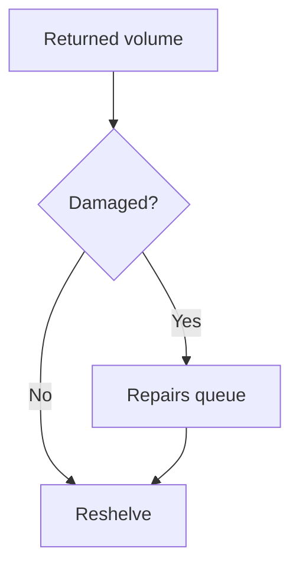
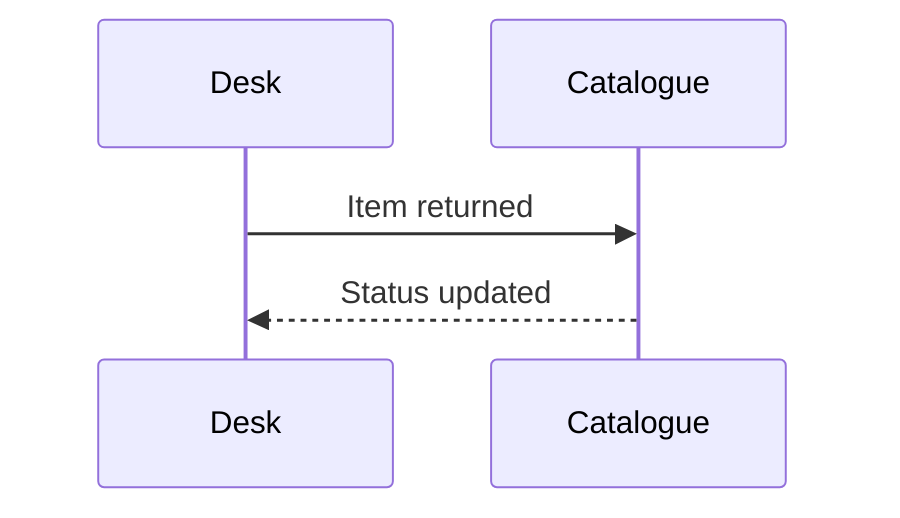
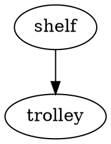

# Returns procedure

Returned volumes travel through sorting, inspection and reshelving before borrowers see them again. Damaged volumes wait for repairs.



The desk and the catalogue exchange two messages for every return.



This one is unfinished and stays as written:

```mermaid
flowchart TD
  Q -->
```

Graphviz is kept as source for now:



Overdue charge: $$c = r \times d$$
