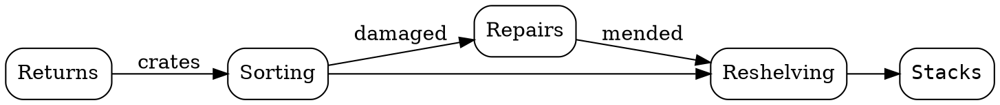
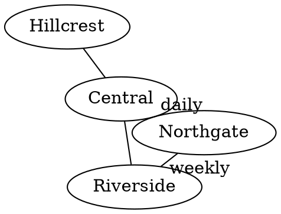

# Shelving routes

Volumes move between rooms in a fixed order. Couriers collect crates from branches each morning, and the sorting room decides where every volume goes next.



Branches share couriers, so their links have no direction:



A plain undirected sketch of the reading room:

```gv
graph room {
  entrance -- periodicals -- fiction;
  entrance -- media;
}
```

This route is unfinished and stays as written:

```dot
digraph {
  desk -> 
}
```

Couriers report delays to the sorting room.
